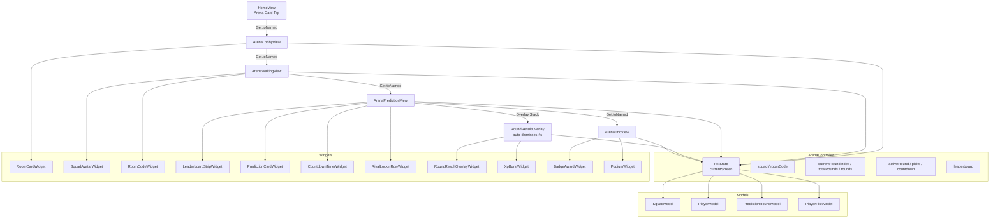
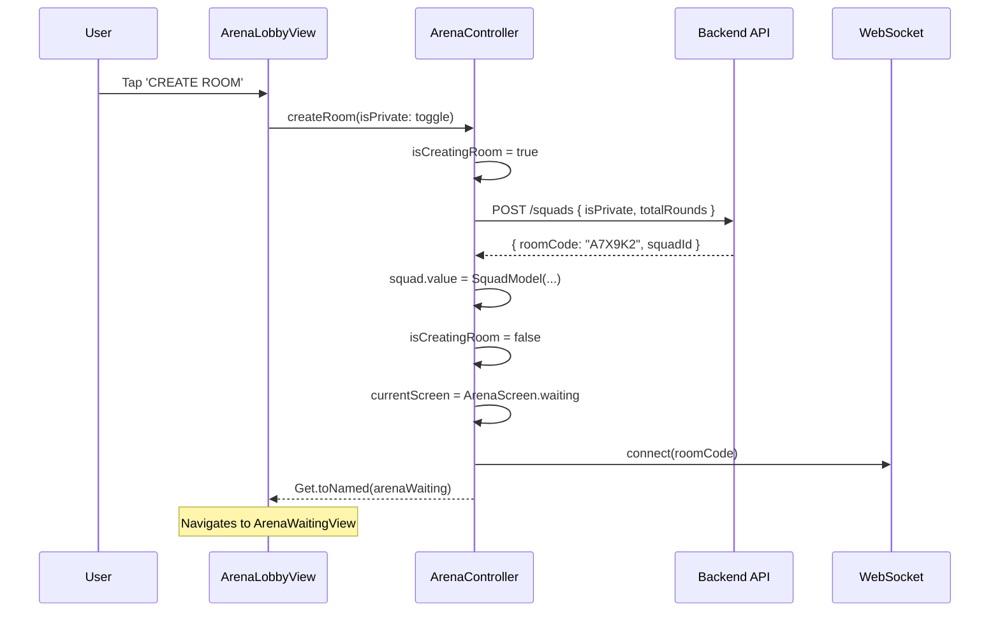
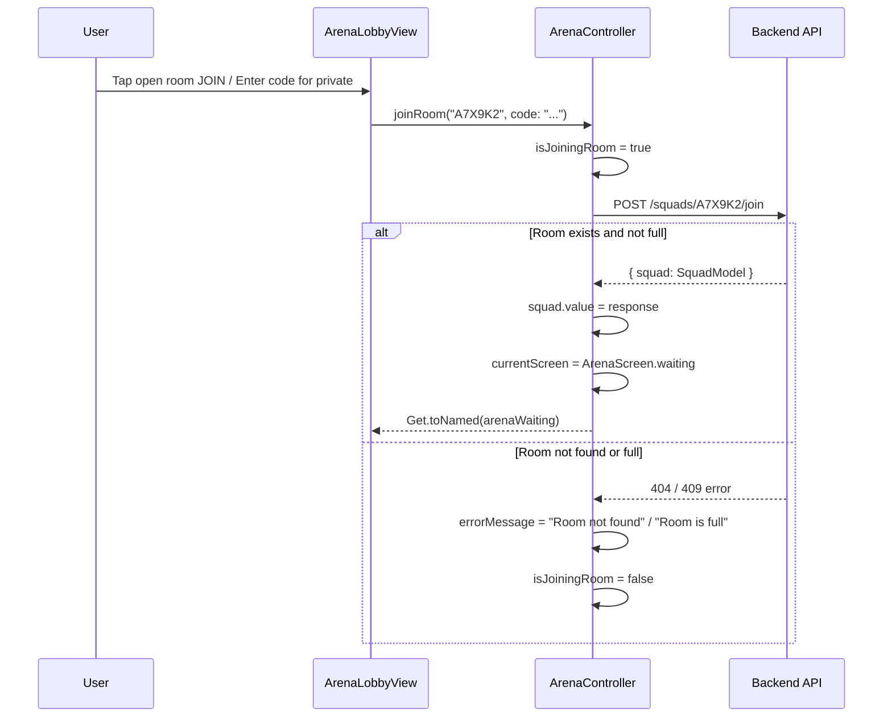
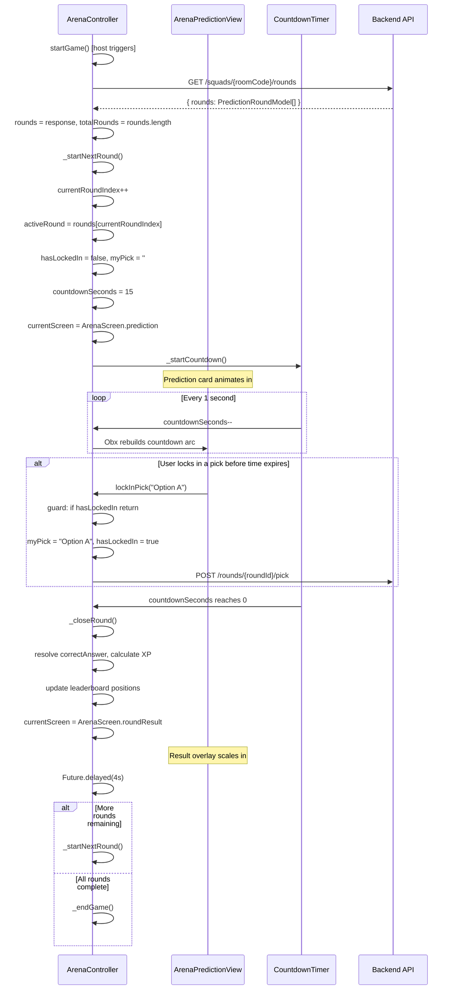
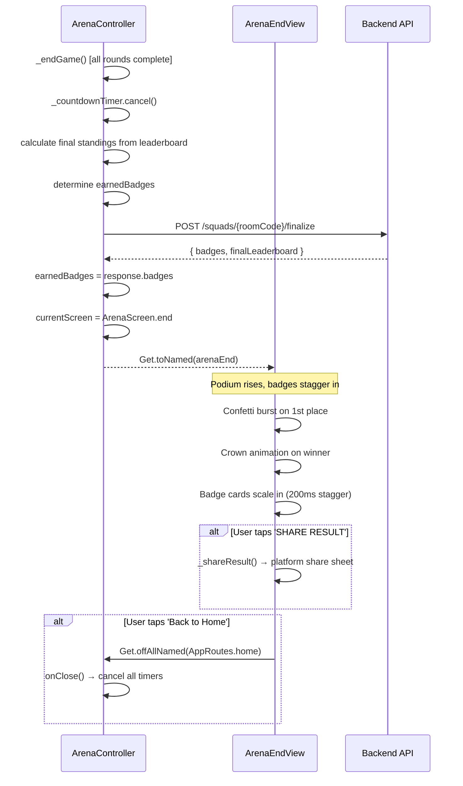

# Design Document: Arena Module

## Overview

The Arena Module is the multiplayer prediction game mode of Live Prediction Arena. It is a **pure prediction game** — there is no live match feed, no scoreboard, no match events. When a user taps the Arena card on the home screen, they enter a game lobby showing available rooms (open or private). Players join a squad of 2–6, wait in a squad lobby for the host to start, then play through a fixed set of prediction rounds (5–10 per game). Each round presents a football prediction question with 2–4 options and a 15-second timer. After each round, results are revealed with XP awards and leaderboard updates. After all rounds complete, the game ends with a podium ceremony, badge awards, and a shareable result card.

The module consists of four views, one central controller, and twelve specialized widgets. The prediction view hosts the round result overlay internally (controlled by `ArenaController` state), while transitions between lobby → waiting → prediction → end use `Get.toNamed`.

**Visual identity**: The entire module uses a game-like visual style — gradient borders, neon glow edges, bold filled icons (shields, lightning, fire, trophies), gradient-filled buttons with glow shadows, dramatic timer arcs, power-up style option buttons, and a victory ceremony end screen with confetti and crowns.

## Architecture



## Module Structure

```
modules/arena/
├── arena_lobby_view.dart
├── arena_waiting_view.dart
├── arena_prediction_view.dart     ← the main game screen (hosts result overlay)
├── arena_end_view.dart
├── controllers/
│   ├── arena_controller.dart
│   └── arena_binding.dart
└── widgets/
    ├── room_card_widget.dart          ← game-style room card for lobby list
    ├── squad_avatar_widget.dart
    ├── room_code_widget.dart
    ├── leaderboard_strip_widget.dart
    ├── prediction_card_widget.dart    ← the question + options card
    ├── countdown_timer_widget.dart
    ├── rival_lockin_row_widget.dart
    ├── round_result_overlay_widget.dart
    ├── xp_burst_widget.dart
    ├── badge_award_widget.dart
    └── podium_widget.dart
```

## Routes

| Route Name | Path | View |
|---|---|---|
| arenaLobby | `/arena/lobby` | ArenaLobbyView |
| arenaWaiting | `/arena/waiting` | ArenaWaitingView |
| arenaPrediction | `/arena/prediction` | ArenaPredictionView |
| arenaEnd | `/arena/end` | ArenaEndView |

## Sequence Diagrams

### Room Creation Flow



### Room Join Flow



### Prediction Round Lifecycle



### Game End Flow



## Data Models

### SquadModel

```dart
/// Represents a game room / squad
class SquadModel {
  final String roomCode;        // 6-character alphanumeric code
  final String hostUserId;      // userId of the room creator
  final String matchTitle;      // display title (e.g., "Football Trivia #42")
  final bool isPrivate;         // requires code to join
  final List<PlayerModel> members;  // max 6 players
  final String status;          // 'waiting' | 'playing' | 'finished'
  final int totalRounds;        // number of prediction rounds (5-10)

  const SquadModel({
    required this.roomCode,
    required this.hostUserId,
    required this.matchTitle,
    required this.isPrivate,
    required this.members,
    required this.status,
    required this.totalRounds,
  });

  factory SquadModel.fromJson(Map<String, dynamic> json);
  Map<String, dynamic> toJson();
}
```

### PlayerModel

```dart
/// Represents a player in the squad
class PlayerModel {
  final String userId;
  final String displayName;
  final Color avatarColor;      // unique color per player
  final int totalXP;            // accumulated XP across all rounds
  final int streak;             // consecutive correct answers
  final List<String> badges;    // earned badge identifiers
  final bool isHost;            // true for room creator
  final bool isConnected;       // WebSocket connection status

  const PlayerModel({
    required this.userId,
    required this.displayName,
    required this.avatarColor,
    this.totalXP = 0,
    this.streak = 0,
    this.badges = const [],
    this.isHost = false,
    this.isConnected = true,
  });

  factory PlayerModel.fromJson(Map<String, dynamic> json);
  Map<String, dynamic> toJson();
}
```

### PredictionRoundModel

```dart
/// Represents a single prediction round / question
class PredictionRoundModel {
  final String roundId;
  final int roundNumber;          // 1-based index
  final String questionText;      // e.g., "Who will score next?"
  final List<String> options;     // 2-4 answer options
  final int timeLimitSeconds;     // always 15
  final String correctAnswer;     // one of the options
  final String category;          // 'goalscorer' | 'result' | 'stats' | 'cards' | 'overunder'

  const PredictionRoundModel({
    required this.roundId,
    required this.roundNumber,
    required this.questionText,
    required this.options,
    this.timeLimitSeconds = 15,
    required this.correctAnswer,
    required this.category,
  });

  factory PredictionRoundModel.fromJson(Map<String, dynamic> json);
  Map<String, dynamic> toJson();
}
```

### PlayerPickModel

```dart
/// Represents a player's pick for a single round
class PlayerPickModel {
  final String userId;
  final String pick;              // the option selected (empty if timed out)
  final bool hasLocked;           // true once submitted
  final int secondsTaken;         // time from round start to lock-in
  final int pointsAwarded;        // XP earned this round
  final bool isCorrect;           // whether pick matches correctAnswer

  const PlayerPickModel({
    required this.userId,
    this.pick = '',
    this.hasLocked = false,
    this.secondsTaken = 0,
    this.pointsAwarded = 0,
    this.isCorrect = false,
  });

  factory PlayerPickModel.fromJson(Map<String, dynamic> json);
  Map<String, dynamic> toJson();
}
```

## Components and Interfaces

### Component 1: ArenaController

**Purpose**: Central state manager for the entire Arena module. Owns all observable state, manages screen transitions, handles the prediction round lifecycle (start game → iterate rounds → end game), and coordinates with the backend API.

```dart
/// modules/arena/controllers/arena_controller.dart
enum ArenaScreen { lobby, waiting, prediction, roundResult, end }

class ArenaController extends GetxController {
  // ── Screen state ──────────────────────────────────────────────
  final Rx<ArenaScreen> currentScreen = ArenaScreen.lobby.obs;

  // ── Room list (lobby) ─────────────────────────────────────────
  final RxList<SquadModel> availableRooms = <SquadModel>[].obs;
  final RxBool isLoadingRooms = false.obs;
  final RxBool isPrivateToggle = false.obs;

  // ── Squad ─────────────────────────────────────────────────────
  final Rx<SquadModel?> squad = Rx(null);
  final RxString roomCodeInput = ''.obs;
  final RxBool isCreatingRoom = false.obs;
  final RxBool isJoiningRoom = false.obs;
  final RxString errorMessage = ''.obs;

  // ── Game state ────────────────────────────────────────────────
  final RxInt currentRoundIndex = 0.obs;
  final RxInt totalRounds = 0.obs;
  final RxList<PredictionRoundModel> rounds = <PredictionRoundModel>[].obs;

  // ── Active prediction round ───────────────────────────────────
  final Rx<PredictionRoundModel?> activeRound = Rx(null);
  final RxList<PlayerPickModel> roundPicks = <PlayerPickModel>[].obs;
  final RxInt countdownSeconds = 15.obs;
  final RxString myPick = ''.obs;
  final RxBool hasLockedIn = false.obs;

  // ── Leaderboard ───────────────────────────────────────────────
  final RxList<PlayerModel> leaderboard = <PlayerModel>[].obs;

  // ── Round result ──────────────────────────────────────────────
  final RxInt xpEarnedThisRound = 0.obs;
  final RxBool wasCorrect = false.obs;
  final RxBool speedBonusEarned = false.obs;
  final RxInt newStreak = 0.obs;

  // ── End of game ───────────────────────────────────────────────
  final RxList<String> earnedBadges = <String>[].obs;

  // ── Timer ─────────────────────────────────────────────────────
  Timer? _countdownTimer;

  // ── Methods ───────────────────────────────────────────────────

  /// Fetches available rooms from API. Sets isLoadingRooms during fetch.
  /// GET /squads?status=waiting
  Future<void> fetchAvailableRooms() async;

  /// Creates a new room. Sets isCreatingRoom, navigates to waiting on success.
  /// POST /squads { isPrivate, totalRounds }
  Future<void> createRoom({required bool isPrivate}) async;

  /// Joins an existing room by code. For open rooms: no code param needed.
  /// For private rooms: code param required (6 chars).
  /// POST /squads/{roomCode}/join
  Future<void> joinRoom(String roomCode, {String? code}) async;

  /// Host starts the game. Fetches rounds from API, begins first round.
  /// GET /squads/{roomCode}/rounds → sets rounds, totalRounds, calls _startNextRound()
  void startGame();

  /// Advances to the next round. Sets activeRound, resets pick state, starts countdown.
  void _startNextRound();

  /// Player locks in their answer. Idempotent — ignored if already locked.
  /// POST /rounds/{roundId}/pick { userId, pick, secondsTaken }
  void lockInPick(String option);

  /// Starts the 15-second countdown timer. Decrements countdownSeconds each second.
  void _startCountdown();

  /// Called when timer hits 0. Resolves correct answer, calculates XP,
  /// updates leaderboard, transitions to roundResult screen.
  void _closeRound();

  /// Called after all rounds complete. Finalizes game, calculates badges,
  /// navigates to end screen.
  void _endGame();

  @override
  void onClose() {
    _countdownTimer?.cancel();
    super.onClose();
  }
}
```

**Responsibilities**:
- Owns all reactive state for the Arena flow
- Manages screen transitions via `currentScreen` observable
- Handles room creation/joining with loading and error states
- Runs the countdown timer and enforces the 15-second limit per round
- Enforces lock-in idempotency (ignores taps after first lock)
- Calculates XP (base 10 for correct + speed bonus up to 5 for fast answers)
- Maintains streak count (consecutive correct answers)
- Updates leaderboard ordering after each round
- Iterates through rounds sequentially until all complete
- Cleans up timer on dispose

### Component 2: ArenaBinding

**Purpose**: GetX dependency injection binding that lazily instantiates the ArenaController when any Arena route is accessed.

```dart
/// modules/arena/controllers/arena_binding.dart
class ArenaBinding extends Bindings {
  @override
  void dependencies() {
    Get.lazyPut<ArenaController>(() => ArenaController());
  }
}
```

**Responsibilities**:
- Registers ArenaController in the GetX dependency container
- Uses `lazyPut` so the controller is only created when first accessed
- Shared across all Arena route registrations

### Component 3: ArenaLobbyView

**Purpose**: Entry screen showing a list of available rooms as game-style lobby cards. Open rooms can be joined with a single tap; private rooms require a 6-digit code. Users can also create their own room (open or private).

```dart
/// modules/arena/arena_lobby_view.dart
class ArenaLobbyView extends GetView<ArenaController> {
  const ArenaLobbyView({super.key});

  @override
  Widget build(BuildContext context);
}
```

**Visual Structure**:
```
Scaffold(backgroundColor: AppColors.background)
└── Stack
    ├── BackgroundWidget (RepaintBoundary)
    └── SafeArea
        └── Column
            ├── // Top bar
            │   Row [BackButton, Spacer, Text('⚔️ ARENA MODE', overline, letterSpacing 2)]
            │
            ├── SizedBox(height: 24)
            │
            ├── // Header
            │   Text('Find a Room', 28px bold white)
            │   SizedBox(height: 4)
            │   Text('Join an open room or enter a code for private ones', 13px textSecondary)
            │
            ├── SizedBox(height: 24)
            │
            ├── // Create Room button — gradient border, game-style
            │   GestureDetector → Container(
            │     decoration: gradient border (arenaAccent → electricBlue),
            │     borderRadius 16, inner padding 16
            │   )
            │   └── Row
            │       ├── Icon(⚡ lightning bolt, arenaAccent, 24)
            │       ├── SizedBox(12)
            │       ├── Expanded: Column [
            │       │     Text('CREATE ROOM', 15px bold white, letterSpacing 1),
            │       │     Text('Start your own squad', 12px textMuted)
            │       │   ]
            │       └── Icon(arrow_forward, electricBlue, 18)
            │   onTap: → show create room bottom sheet
            │
            ├── SizedBox(height: 24)
            │
            ├── // Room list header
            │   Row [Text('AVAILABLE ROOMS', 11px bold textMuted, letterSpacing 2),
            │        Spacer,
            │        Obx: Text('${rooms.length} rooms', 11px textMuted)]
            │
            ├── SizedBox(height: 12)
            │
            ├── // Room list
            │   Expanded: Obx(() =>
            │     controller.isLoadingRooms.value
            │       ? Center(CircularProgressIndicator(color: arenaAccent))
            │       : controller.availableRooms.isEmpty
            │         ? _EmptyState('No rooms available. Create one!')
            │         : ListView.separated(
            │             itemCount: rooms.length,
            │             separatorBuilder: SizedBox(height: 12),
            │             itemBuilder: (_, i) => RoomCardWidget(room: rooms[i])
            │           )
            │   )
            │
            └── // Error message
                Obx: if errorMessage != '' → Text(error, 12px AppColors.error)
```

**Create Room Bottom Sheet** (game-style):
```
showModalBottomSheet → Container(cardSurface, top borderRadius 24,
  gradient top border: arenaAccent → electricBlue)
└── Padding(24)
    └── Column
        ├── Row [Icon(⚡, arenaAccent), SizedBox(8), Text('Create a Room', 22px bold white)]
        ├── SizedBox(16)
        ├── // Game title input
        │   Text('GAME TITLE', 11px textMuted, letterSpacing 2)
        │   SizedBox(6)
        │   TextField(hint: 'Football Trivia', gradient border on focus)
        ├── SizedBox(16)
        ├── // Privacy toggle — game-style switch
        │   Container(cardSurface, gradient border, borderRadius 14, padding 16)
        │   └── Row [
        │         Icon(🔒 lock, textMuted),
        │         SizedBox(8),
        │         Column [
        │           Text('Private Room', 14px white),
        │           Text('Requires code to join', 11px textMuted)
        │         ],
        │         Spacer,
        │         Obx: Switch(value: isPrivateToggle, activeColor: arenaAccent)
        │       ]
        ├── SizedBox(24)
        └── // Create button — gradient fill with glow
            Container(
              height: 56, borderRadius: 14,
              gradient: LinearGradient(arenaAccent, electricBlue),
              boxShadow: [arenaAccent.withOpacity(0.3), blur: 12]
            )
            └── Center: Text('⚡ CREATE ROOM', 15px bold white, letterSpacing 1, uppercase)
            onTap: controller.createRoom(isPrivate: isPrivateToggle.value)
```

**Private Room Join Dialog**:
```
showDialog → Container(cardSurface, borderRadius 20, gradient border)
└── Padding(24)
    └── Column
        ├── Icon(🔒, 32, arenaAccent)
        ├── SizedBox(12)
        ├── Text('Enter Room Code', 18px bold white)
        ├── SizedBox(8)
        ├── Text('This room is private. Enter the 6-digit code.', 13px textSecondary)
        ├── SizedBox(20)
        ├── RoomCodeWidget (6-char input, editable mode)
        ├── SizedBox(16)
        ├── Row [
        │     TextButton('Cancel', textMuted),
        │     SizedBox(12),
        │     GradientButton('JOIN', enabled when code.length == 6)
        │   ]
        └── Obx: if errorMessage != '' → Text(error, 12px)
```

**Responsibilities**:
- Fetches available rooms on mount via `controller.fetchAvailableRooms()`
- Displays rooms as game-style lobby cards with gradient borders
- Open rooms: single tap to join immediately
- Private rooms: tap shows code input dialog, validates 6-char code, then joins
- Create room: bottom sheet with privacy toggle, creates room and navigates to waiting
- Pull-to-refresh to reload room list
- Entrance animations: room cards stagger slide up + fade in (500ms, easeOutCubic, 100ms stagger)
- CREATE ROOM card has subtle shimmer sweep animation

### Component 4: ArenaWaitingView

**Purpose**: Squad lobby showing connected players, the shareable room code, and a start button for the host. Feels like a pre-game staging area.

```dart
/// modules/arena/arena_waiting_view.dart
class ArenaWaitingView extends GetView<ArenaController> {
  const ArenaWaitingView({super.key});

  @override
  Widget build(BuildContext context);
}
```

**Visual Structure**:
```
Scaffold(backgroundColor: AppColors.background)
└── Stack
    ├── BackgroundWidget
    └── SafeArea → Column
        ├── // Top bar
        │   Row [BackButton, Spacer, Text('🛡️ SQUAD LOBBY', overline)]
        │
        ├── SizedBox(height: 32)
        │
        ├── // Room code display — prominent, shareable
        │   RoomCodeWidget(code: squad.roomCode)
        │   SizedBox(8)
        │   Text('Share this code with your squad', 13px textSecondary, center)
        │
        ├── SizedBox(height: 32)
        │
        ├── // Players section
        │   Text('PLAYERS (${members.length}/6)', 11px bold textMuted, letterSpacing 2)
        │   SizedBox(12)
        │   GridView.count(crossAxisCount: 3, shrinkWrap: true)
        │   └── 6 slots: SquadAvatarWidget(player: members[i] or null)
        │
        ├── Spacer
        │
        ├── // Game info
        │   Container(cardSurface, gradient border, borderRadius 14, padding 16)
        │   └── Row [
        │         Icon(🎯, arenaAccent),
        │         SizedBox(8),
        │         Text('${totalRounds} rounds · 15s per question', 14px textSecondary)
        │       ]
        │
        ├── SizedBox(height: 16)
        │
        └── // Action button
            Obx: controller.squad.value?.hostUserId == currentUserId
              ? // Host: START GAME button — gradient fill with glow
                Container(
                  height: 56, borderRadius: 14,
                  gradient: LinearGradient(arenaAccent, electricBlue),
                  boxShadow: [arenaAccent.withOpacity(0.3), blur: 12],
                  animated ripple glow border
                )
                └── Center: Text('⚡ START GAME', 16px bold white, letterSpacing 1)
                onTap: controller.startGame()
              : // Non-host: waiting indicator
                Column [
                  Text('Waiting for host to start...', 14px textSecondary),
                  SizedBox(4),
                  LinearProgressIndicator(color: arenaAccent, pulsing)
                ]
```

**Responsibilities**:
- Displays room code prominently for sharing
- Shows real-time player join/leave via Obx
- New player avatars pop in with scale spring animation (600ms, elasticOut)
- Host-only start button with animated ripple glow border
- Non-host players see pulsing "Waiting for host..." indicator
- Minimum 2 players required to start (button disabled otherwise)

### Component 5: ArenaPredictionView

**Purpose**: The main game screen. Displays the current prediction round as a challenge card with countdown timer, answer options, rival lock-in status, and a compact leaderboard. Hosts the round result overlay when a round ends.

```dart
/// modules/arena/arena_prediction_view.dart
class ArenaPredictionView extends GetView<ArenaController> {
  const ArenaPredictionView({super.key});

  @override
  Widget build(BuildContext context);
}
```

**Visual Structure**:
```
Scaffold(backgroundColor: AppColors.background)
└── Stack
    ├── BackgroundWidget
    ├── SafeArea → Column
    │   ├── // Top bar — round progress
    │   │   Row [
    │   │     Text('ROUND ${currentRoundIndex}/${totalRounds}', 12px bold textMuted),
    │   │     Spacer,
    │   │     // Round progress dots
    │   │     Row: rounds.map((r) => dot(6px, filled if completed))
    │   │   ]
    │   │
    │   ├── SizedBox(height: 16)
    │   │
    │   ├── // Leaderboard strip (compact, horizontal)
    │   │   LeaderboardStripWidget
    │   │
    │   ├── SizedBox(height: 16)
    │   │
    │   ├── // Prediction card — the main challenge
    │   │   Expanded: PredictionCardWidget
    │   │
    │   ├── SizedBox(height: 12)
    │   │
    │   └── // Rival lock-in row
    │       RivalLockInRowWidget
    │
    └── // Round result overlay (conditionally shown)
        Obx: if currentScreen == ArenaScreen.roundResult
          → RoundResultOverlayWidget (centered, with backdrop blur)
```

**Responsibilities**:
- Displays the active prediction round as a dramatic challenge card
- Shows round progress (e.g., "ROUND 3/7") with dot indicators
- Compact leaderboard visible during gameplay
- Rival lock-in indicators show who has answered
- Hosts the round result overlay as a Stack layer (no route push)
- Backdrop blur (sigma 6) activates when result overlay is shown
- Transitions to ArenaEndView after final round result dismisses

### Component 6: ArenaEndView

**Purpose**: Final victory ceremony screen showing podium, full leaderboard, earned badges, and share functionality. Feels like a mobile game victory screen.

```dart
/// modules/arena/arena_end_view.dart
class ArenaEndView extends GetView<ArenaController> {
  const ArenaEndView({super.key});

  @override
  Widget build(BuildContext context);
}
```

**Visual Structure**:
```
Scaffold(backgroundColor: AppColors.background)
└── Stack
    ├── BackgroundWidget
    ├── // Confetti overlay (triggered on mount)
    │   ConfettiWidget (particles: 50, duration: 3s, colors: gold/arenaAccent/electricBlue)
    └── SafeArea → SingleChildScrollView → Column
        ├── SizedBox(height: 24)
        ├── // Header
        │   Text('🏆', 48px)
        │   SizedBox(8)
        │   Text('GAME OVER', 12px bold textMuted, letterSpacing 3)
        │   Text('Final Standings', 28px bold white)
        │
        ├── SizedBox(height: 32)
        │
        ├── // Podium — victory ceremony style
        │   PodiumWidget(leaderboard: controller.leaderboard)
        │
        ├── SizedBox(height: 24)
        │
        ├── // Full results list
        │   Text('ALL PLAYERS', 11px bold textMuted, letterSpacing 2)
        │   SizedBox(8)
        │   ...leaderboard.map((player) => _PlayerResultRow(player, rank))
        │
        ├── SizedBox(height: 24)
        │
        ├── // Badges earned section
        │   if earnedBadges.isNotEmpty:
        │     Text('🎖️ BADGES EARNED', 11px bold textMuted, letterSpacing 2)
        │     SizedBox(8)
        │     Wrap: earnedBadges.map((b) => BadgeAwardWidget(badge: b))
        │
        ├── SizedBox(height: 32)
        │
        ├── // Share button — animated gradient border shimmer
        │   Container(
        │     height: 56, borderRadius: 14,
        │     gradient: LinearGradient(arenaAccent, electricBlue),
        │     boxShadow: [arenaAccent.withOpacity(0.3), blur: 12],
        │     shimmer border animation (loop)
        │   )
        │   └── Row(center) [Icon(share), SizedBox(8), Text('SHARE RESULT', bold)]
        │   onTap: _shareResult()
        │
        ├── SizedBox(height: 12)
        │
        └── // Back to home
            TextButton('Back to Home', textSecondary)
            onTap: Get.offAllNamed(AppRoutes.home)
```

**Responsibilities**:
- Celebrates the winner with podium and confetti burst
- Winner gets animated crown icon above their podium column
- Displays all earned badges with staggered entrance animations (200ms stagger)
- Provides share functionality for results (platform share sheet)
- Clean exit back to home (clears navigation stack, disposes controller)
- Podium columns rise with staggered animation (2nd → 1st → 3rd, 400ms each)

### Component 7: RoomCardWidget

**Purpose**: Game-style lobby card for displaying a room in the lobby list. Looks like a "game lobby card" with accent strip, player count as avatar stack, and status pill badge.

```dart
/// modules/arena/widgets/room_card_widget.dart
class RoomCardWidget extends StatelessWidget {
  final SquadModel room;

  const RoomCardWidget({super.key, required this.room});

  @override
  Widget build(BuildContext context);
}
```

**Visual Structure**:
```
Container(
  borderRadius: 16,
  gradient border: LinearGradient(
    room.isPrivate ? fantasyAccent → fantasyAccent.withOpacity(0.3)
                   : arenaAccent → arenaAccent.withOpacity(0.3)
  ),
  background: cardSurface,
  boxShadow: subtle glow (accent at 10% opacity, blur 8)
)
└── IntrinsicHeight → Row
    ├── // Left accent strip (3px wide, full height)
    │   Container(width: 3, color: room.isPrivate ? fantasyAccent : arenaAccent)
    │
    └── Expanded → Padding(16)
        └── Row
            ├── // Room info
            │   Expanded → Column(crossAxisAlignment: start)
            │   ├── Row [
            │   │   Text(room.matchTitle, 15px bold white),
            │   │   SizedBox(8),
            │   │   if room.isPrivate: Container(
            │   │     padding: 4/8, borderRadius: 8,
            │   │     color: fantasyAccent.withOpacity(0.15),
            │   │     child: Row [Icon(🔒, 10), SizedBox(4), Text('PRIVATE', 9px fantasyAccent)]
            │   │   )
            │   │   else: Container(
            │   │     padding: 4/8, borderRadius: 8,
            │   │     color: neonGreen.withOpacity(0.15),
            │   │     child: Row [Icon(🔓, 10), SizedBox(4), Text('OPEN', 9px neonGreen)]
            │   │   )
            │   │ ]
            │   ├── SizedBox(6)
            │   ├── // Player count as mini avatar stack
            │   │   Row [
            │   │     _AvatarStack(members, maxShow: 3),  // overlapping 20px circles
            │   │     SizedBox(8),
            │   │     Text('${members.length}/6', 12px textSecondary)
            │   │   ]
            │   └── SizedBox(4)
            │   └── // Status pill
            │       Container(
            │         padding: 3/10, borderRadius: 10,
            │         color: arenaAccent.withOpacity(0.15),
            │         child: Text('⏳ WAITING', 10px bold arenaAccent)
            │       )
            │
            └── // Join action
                Column(mainAxisAlignment: center)
                └── if room.isPrivate:
                      Container(40×40, borderRadius 12, gradient border)
                      └── Icon(🔒, 18, textMuted)
                    else:
                      Container(
                        padding: 8/16, borderRadius: 12,
                        gradient: LinearGradient(arenaAccent, electricBlue),
                        boxShadow: arenaAccent glow
                      )
                      └── Text('JOIN', 12px bold white, letterSpacing 1)
```

**Responsibilities**:
- Renders room as a game-style card with gradient border
- Left accent strip color indicates open (arenaAccent) vs private (fantasyAccent)
- Player count shown as overlapping avatar circles + count text
- Status shown as glowing pill badge
- Tap on open room → immediate join
- Tap on private room → shows code input dialog
- Press animation: scale 0.98 → 1.0 (150ms)

### Component 8: SquadAvatarWidget

**Purpose**: Displays a player's avatar circle (filled) or an empty slot placeholder in the waiting room grid.

```dart
/// modules/arena/widgets/squad_avatar_widget.dart
class SquadAvatarWidget extends StatelessWidget {
  final PlayerModel? player;
  final double size;

  const SquadAvatarWidget({
    super.key,
    this.player,
    this.size = 64,
  });

  @override
  Widget build(BuildContext context);
}
```

**Filled slot rendering**:
- Circle container (size × size) with player.avatarColor fill
- Gradient border (arenaAccent → electricBlue, 2.5px) with glow shadow
- Centered initials text (22px bold white)
- If isHost: small crown icon (👑) positioned top-right
- Player displayName below (11px textSecondary)
- Connection indicator: green dot (6px) bottom-left if isConnected

**Empty slot rendering**:
- Circle container with cardSurface fill
- Dashed border (cardBorder color, 1.5px) — pulsing opacity (0.3 → 0.6, 1500ms)
- Centered add icon (Icons.person_add_outlined, textMuted, 20)
- 'Waiting...' text below (11px textMuted)

### Component 9: RoomCodeWidget

**Purpose**: Large, styled display of the 6-character room code for sharing. Each character rendered in its own gradient-bordered box.

```dart
/// modules/arena/widgets/room_code_widget.dart
class RoomCodeWidget extends StatelessWidget {
  final String code;

  const RoomCodeWidget({super.key, required this.code});

  @override
  Widget build(BuildContext context);
}
```

**Rendering**: Row of 6 individual character containers:
- Each: 44×52px, cardSurface background, borderRadius 12
- Border: gradient (arenaAccent → electricBlue), 1.5px width
- Character: 28px bold white, centered
- Subtle inner glow: arenaAccent at 5% opacity
- Tap-to-copy: tapping the row copies code to clipboard + shows snackbar

### Component 10: LeaderboardStripWidget

**Purpose**: Displays the squad leaderboard sorted by totalXP descending, with animated rank changes, streak indicators, and game-style rank badges.

```dart
/// modules/arena/widgets/leaderboard_strip_widget.dart
class LeaderboardStripWidget extends StatelessWidget {
  const LeaderboardStripWidget({super.key});

  @override
  Widget build(BuildContext context);
}
```

**Visual Structure**:
```
Container(cardSurface, gradient border, borderRadius 16, padding 12)
└── Column
    ├── Row [
    │   Icon(🏆, 14, arenaAccent),
    │   SizedBox(6),
    │   Text('LEADERBOARD', 10px bold textMuted, letterSpacing 2)
    │ ]
    ├── SizedBox(height: 8)
    └── Column (sorted by totalXP desc)
        └── each row: AnimatedContainer(duration: 600ms)
            └── Padding(vertical: 4)
                └── Row
                    ├── // Rank badge
                    │   Container(22×22, circle)
                    │   rank 1: gold gradient fill + '🥇'
                    │   rank 2: silver gradient fill + '🥈'
                    │   rank 3: bronze gradient fill + '🥉'
                    │   rank 4+: cardBorder fill + rank number (11px textMuted)
                    │
                    ├── SizedBox(8)
                    ├── // Avatar (small)
                    │   Container(28×28, circle, avatarColor, initials 10px)
                    │   if rank == 1: glow shadow (gold, blur 8)
                    │
                    ├── SizedBox(8)
                    ├── Expanded: Text(displayName, 13px white)
                    │
                    ├── // Streak indicator
                    │   if streak >= 3:
                    │     Container(padding 2/6, borderRadius 8, neonGreen.withOpacity(0.15))
                    │     └── Text('🔥${streak}', 11px neonGreen bold)
                    │
                    ├── SizedBox(8)
                    └── // XP
                        Text('${totalXP}', 13px bold arenaAccent)
                        Text(' XP', 10px textMuted)
```

**Animations**:
- Rows animate to new positions on rank change (600ms, easeInOut)
- XP values count up with TweenAnimationBuilder (800ms)
- Rank 1 row has subtle gold glow border that pulses

### Component 11: PredictionCardWidget

**Purpose**: The main challenge card that presents the prediction question, answer options, and countdown timer. Feels like a "challenge card" — bold question, dramatic timer arc, power-up style option buttons.

```dart
/// modules/arena/widgets/prediction_card_widget.dart
class PredictionCardWidget extends StatelessWidget {
  const PredictionCardWidget({super.key});

  @override
  Widget build(BuildContext context);
}
```

**Visual Structure**:
```
Container(
  borderRadius: 20,
  gradient border: LinearGradient(arenaAccent, electricBlue),
  background: cardSurface,
  boxShadow: arenaAccent at 15% opacity, blur 16
)
└── Padding(20)
    └── Column
        ├── // Category badge pill — gradient background
        │   Container(
        │     padding: 6/14, borderRadius: 20,
        │     gradient: LinearGradient(arenaAccent.withOpacity(0.2), electricBlue.withOpacity(0.2)),
        │     border: arenaAccent at 40% opacity
        │   )
        │   └── Row [
        │         _categoryIcon(category),  // ⚽ for goalscorer, 📊 for stats, etc.
        │         SizedBox(6),
        │         Text(category.toUpperCase(), 10px bold arenaAccent, letterSpacing 1)
        │       ]
        │
        ├── SizedBox(height: 20)
        │
        ├── // Question text — large, bold, centered
        │   Text(questionText, 22px bold white, textAlign: center, maxLines: 3)
        │
        ├── SizedBox(height: 20)
        │
        ├── // Countdown timer — dramatic circular arc
        │   Center: CountdownTimerWidget(seconds: countdownSeconds, totalSeconds: 15)
        │
        ├── SizedBox(height: 20)
        │
        ├── // Answer options — power-up style buttons
        │   Column(spacing: 10)
        │   └── options.map((option) => AnswerOptionButton(
        │         label: option,
        │         isSelected: myPick == option,
        │         isLocked: hasLockedIn,
        │         onTap: () => controller.lockInPick(option),
        │       ))
        │
        └── SizedBox(height: 8)
```

**AnswerOptionButton** (inline widget):
```dart
class AnswerOptionButton extends StatelessWidget {
  final String label;
  final bool isSelected;
  final bool isLocked;
  final VoidCallback onTap;
}
```

**States**:
- **Unselected**: cardSurface background, gradient border (arenaAccent at 30% → electricBlue at 30%), white text (15px bold), height 56px, borderRadius 14
- **Selected (locked)**: gradient fill (arenaAccent → electricBlue), lock icon (🔒) appears left of text, white text, glow shadow (arenaAccent at 40%, blur 12), pulse animation once (scale 1.0 → 1.03 → 1.0, 300ms)
- **Disabled** (another option locked): opacity 0.3, no tap response
- **Tap feedback**: scale 0.97 → 1.0 spring (150ms)

### Component 12: CountdownTimerWidget

**Purpose**: Circular arc countdown timer using CustomPainter. Displays remaining seconds with color transitions based on urgency. Dramatic visual — the arc depletes as time runs out.

```dart
/// modules/arena/widgets/countdown_timer_widget.dart
class CountdownTimerWidget extends StatelessWidget {
  final int seconds;
  final int totalSeconds;

  const CountdownTimerWidget({
    super.key,
    required this.seconds,
    this.totalSeconds = 15,
  });

  @override
  Widget build(BuildContext context);
}
```

**Visual Structure**:
```
Stack(alignment: center)
├── SizedBox(80×80)
│   └── CustomPaint(_CountdownArcPainter)
│       - Background circle: cardBorder, strokeWidth 6, strokeCap round
│       - Foreground arc: sweepAngle = 2π × (seconds / totalSeconds)
│         Color transitions:
│           > 10s: electricBlue (calm)
│           5–10s: warning/amber (Color(0xFFFFB300))
│           < 5s: error/red (AppColors.error)
│         Glow: arc color at 40% opacity, blur 4 (painted behind)
└── Column(center)
    ├── Text(seconds.toString(), 28px bold white)
    └── Text('SEC', 9px textMuted, letterSpacing 1)
```

**Danger mode** (seconds <= 5):
- Text color shifts to error red
- Scale pulse: 1.0 → 1.15 → 1.0 (500ms loop, easeInOut)
- Arc glow intensifies (60% opacity, blur 8)

### Component 13: RivalLockInRowWidget

**Purpose**: Compact row showing each squad member's avatar with a lock indicator when they've submitted their pick. Creates social pressure to answer quickly.

```dart
/// modules/arena/widgets/rival_lockin_row_widget.dart
class RivalLockInRowWidget extends StatelessWidget {
  final List<PlayerPickModel> picks;
  final List<PlayerModel> players;

  const RivalLockInRowWidget({
    super.key,
    required this.picks,
    required this.players,
  });

  @override
  Widget build(BuildContext context);
}
```

**Visual Structure**:
```
Container(cardSurface, gradient border at 20% opacity, borderRadius 14, padding 12)
└── Column
    ├── Text('SQUAD STATUS', 9px bold textMuted, letterSpacing 2)
    ├── SizedBox(6)
    └── Row(mainAxisAlignment: spaceEvenly)
        └── for each player:
            Column
            ├── Stack
            │   ├── Container(36×36 circle, avatarColor, initials 12px)
            │   │   if hasLocked: border changes to neonGreen (2px)
            │   │   if !hasLocked: border is cardBorder (1px)
            │   └── if hasLocked: Positioned(bottom: -2, right: -2)
            │       Container(14×14 circle, neonGreen fill)
            │       └── Icon(✓, 8px, white)
            └── SizedBox(4)
            └── Text(firstName, 9px textMuted)
```

**Lock-in animation**: When a rival locks in, their avatar border flashes neonGreen (opacity 0 → 1, 300ms) and the checkmark scales in (0 → 1, elasticOut, 400ms).

### Component 14: RoundResultOverlayWidget

**Purpose**: Centered modal overlay showing whether the player's pick was correct, XP earned, bonuses, streak update, and a mini leaderboard. Auto-dismisses after 4 seconds.

```dart
/// modules/arena/widgets/round_result_overlay_widget.dart
class RoundResultOverlayWidget extends StatelessWidget {
  const RoundResultOverlayWidget({super.key});

  @override
  Widget build(BuildContext context);
}
```

**Visual Structure**:
```
Container(full screen, color: black 60% opacity)
└── BackdropFilter(blur sigma 6)
    └── Center
        └── Container(
              width: screenWidth - 48,
              borderRadius: 24,
              background: cardSurface,
              gradient border: wasCorrect
                ? LinearGradient(neonGreen, neonGreen.withOpacity(0.3))
                : LinearGradient(error, error.withOpacity(0.3)),
              boxShadow: resultColor at 30% opacity, blur 24
            )
            └── Padding(24)
                └── Column
                    ├── // Result icon burst
                    │   XpBurstWidget(isCorrect: wasCorrect)
                    │
                    ├── SizedBox(16)
                    │
                    ├── // Result text
                    │   wasCorrect
                    │     ? Text('✓ Correct!', 24px bold neonGreen)
                    │     : Text('✗ Wrong', 24px bold error)
                    │
                    ├── SizedBox(8)
                    │
                    ├── // Correct answer reveal
                    │   Text('Answer: ${correctAnswer}', 14px textSecondary)
                    │
                    ├── SizedBox(20)
                    │
                    ├── // XP earned — count-up animation
                    │   TweenAnimationBuilder(duration: 800ms, 0 → xpEarnedThisRound)
                    │   └── Text('+${value} XP', 36px bold arenaAccent)
                    │
                    ├── SizedBox(12)
                    │
                    ├── // Bonuses row
                    │   Row(center)
                    │   ├── if speedBonusEarned:
                    │   │   Container(pill, neonGreen.withOpacity(0.15), border neonGreen)
                    │   │   └── Text('⚡ Speed +5', 11px neonGreen bold)
                    │   ├── SizedBox(8)
                    │   └── if newStreak >= 3:
                    │       Container(pill, warning.withOpacity(0.15), border warning)
                    │       └── Text('🔥 ${newStreak}× Streak', 11px warning bold)
                    │
                    ├── SizedBox(16)
                    │
                    ├── // Divider
                    │   Container(height: 1, color: cardBorder)
                    │
                    ├── SizedBox(12)
                    │
                    └── // Mini leaderboard (top 3)
                        Column
                        └── top 3 players: Row [rank badge, avatar, name, xp]
```

**Entrance**: Scale 0.8 → 1.0 + fade in, 350ms, easeOutBack.
**Exit**: Scale 1.0 → 0.9 + fade out, 200ms, easeIn. Auto-dismisses after 4 seconds.

### Component 15: XpBurstWidget

**Purpose**: Animated result icon — celebratory burst for correct answers (like a mobile game "+XP" burst), shake for wrong answers.

```dart
/// modules/arena/widgets/xp_burst_widget.dart
class XpBurstWidget extends StatefulWidget {
  final bool isCorrect;

  const XpBurstWidget({super.key, required this.isCorrect});

  @override
  State<XpBurstWidget> createState() => _XpBurstWidgetState();
}
```

**Correct answer animation**:
- Large ✓ icon (32px) in a circle (64×64)
- Circle scales 0 → 1.2 → 1.0 with elasticOut (600ms)
- Circle fill: radial gradient (neonGreen center → neonGreen.withOpacity(0.3) edge)
- 8 particle lines burst outward from center (CustomPainter)
- Each line: 2px wide, arenaAccent, length 20px, fades out over 500ms
- Lines rotate 45° apart, expand from radius 32 → 52

**Wrong answer animation**:
- Large ✗ icon (32px) in a circle (64×64)
- Circle fill: radial gradient (error center → error.withOpacity(0.3) edge)
- Shake: translate x 0 → -8 → 8 → -4 → 4 → 0 (400ms)
- No particle burst

### Component 16: BadgeAwardWidget

**Purpose**: Displays an earned badge as a hexagonal/shield-shaped card with glow effect. Used in the end screen.

```dart
/// modules/arena/widgets/badge_award_widget.dart
class BadgeAwardWidget extends StatelessWidget {
  final String badge;

  const BadgeAwardWidget({super.key, required this.badge});

  @override
  Widget build(BuildContext context);
}
```

**Visual Structure**:
```
Container(
  width: 100, height: 120,
  decoration: BoxDecoration(
    borderRadius: 16,
    gradient: LinearGradient(topCenter → bottomCenter,
      arenaAccent.withOpacity(0.2) → electricBlue.withOpacity(0.1)),
    border: gradient (arenaAccent → electricBlue), 1.5px,
    boxShadow: arenaAccent at 20% opacity, blur 12
  )
)
└── Column(center)
    ├── // Badge icon (shield shape via ClipPath or icon)
    │   Container(48×48)
    │   └── Icon(_badgeIcon(badge), 28, arenaAccent)
    ├── SizedBox(8)
    └── Text(badge, 10px bold textSecondary, center, maxLines: 2)
```

**Badge types**: "Perfect Round" (all correct), "Speed Demon" (fastest avg), "Streak Master" (longest streak), "Comeback King" (worst to top 3), "Consistent" (no wrong answers).

**Entrance animation**: Scale 0 → 1.0 with elasticOut (500ms), staggered 200ms per badge.

### Component 17: PodiumWidget

**Purpose**: Three-column podium layout for the end screen showing 1st, 2nd, and 3rd place with rising column animations. Victory ceremony feel — gradient columns, crown on winner, dramatic reveal.

```dart
/// modules/arena/widgets/podium_widget.dart
class PodiumWidget extends StatelessWidget {
  final List<PlayerModel> leaderboard;

  const PodiumWidget({super.key, required this.leaderboard});

  @override
  Widget build(BuildContext context);
}
```

**Visual Structure**:
```
SizedBox(height: 220)
└── Row(crossAxisAlignment: end, mainAxisAlignment: center)
    ├── // 2nd place (left)
    │   _PodiumColumn(
    │     rank: 2, player: leaderboard[1],
    │     height: 100,
    │     gradient: LinearGradient(Color(0xFFC0C0C0), Color(0xFF808080)),  // silver
    │   )
    │
    ├── SizedBox(width: 8)
    │
    ├── // 1st place (center, tallest)
    │   _PodiumColumn(
    │     rank: 1, player: leaderboard[0],
    │     height: 140,
    │     gradient: LinearGradient(Color(0xFFFFD700), Color(0xFFFF8C00)),  // gold
    │     showCrown: true,
    │   )
    │
    ├── SizedBox(width: 8)
    │
    └── // 3rd place (right)
        _PodiumColumn(
          rank: 3, player: leaderboard[2],
          height: 70,
          gradient: LinearGradient(Color(0xFFCD7F32), Color(0xFF8B4513)),  // bronze
        )

_PodiumColumn:
  Column(center)
  ├── if showCrown: Text('👑', 28px) with bounce animation
  ├── SizedBox(4)
  ├── // Avatar
  │   Container(48×48, circle, avatarColor, initials 18px)
  │   Border: gradient matching podium color, 2.5px
  │   Glow: podium color at 40% opacity, blur 12
  ├── SizedBox(4)
  ├── Text(displayName, 12px bold white)
  ├── Text('${totalXP} XP', 11px arenaAccent bold)
  ├── SizedBox(6)
  └── // Podium column
      Container(
        width: 80, height: podiumHeight,
        borderRadius: top 12,
        gradient: podiumGradient,
        boxShadow: gradient start color at 30%, blur 8
      )
      └── Center: Text(rank emoji, 20px)  // 🥇 🥈 🥉
```

**Animations**:
- Columns rise from height 0 → final height (staggered: 2nd at 0ms, 1st at 300ms, 3rd at 600ms)
- Duration: 500ms each, easeOutCubic
- Crown bounces in after 1st place column finishes (scale 0 → 1.2 → 1.0, elasticOut)
- Avatars fade in as columns reach 50% height

## Key Functions — Formal Specifications

### `fetchAvailableRooms()`

```
PRE:  currentScreen == ArenaScreen.lobby
POST: availableRooms contains all rooms with status == 'waiting'
      isLoadingRooms == false
      rooms are sorted by member count descending (fullest first)
SIDE: GET /squads?status=waiting called
ERROR: on network failure → errorMessage set, availableRooms unchanged
```

### `createRoom({required bool isPrivate})`

```
PRE:  !isCreatingRoom
POST: squad.value != null
      squad.value.roomCode.length == 6
      squad.value.hostUserId == currentUser.id
      squad.value.isPrivate == isPrivate
      squad.value.members.length == 1 (host only)
      currentScreen == ArenaScreen.waiting
      isCreatingRoom == false
SIDE: POST /squads called
      WebSocket connection established for roomCode
      Navigation: Get.toNamed(arenaWaiting)
ERROR: on failure → errorMessage set, isCreatingRoom = false, no navigation
```

### `joinRoom(String roomCode, {String? code})`

```
PRE:  !isJoiningRoom
      roomCode.length == 6
      if target room isPrivate → code != null && code.length == 6
POST: squad.value != null
      squad.value.members contains current user
      squad.value.members.length <= 6
      currentScreen == ArenaScreen.waiting
      isJoiningRoom == false
SIDE: POST /squads/{roomCode}/join called
      Navigation: Get.toNamed(arenaWaiting)
ERROR: 404 → errorMessage = "Room not found"
       409 → errorMessage = "Room is full"
       403 → errorMessage = "Invalid code"
       isJoiningRoom = false, no navigation
```

### `startGame()`

```
PRE:  squad.value != null
      squad.value.hostUserId == currentUser.id
      squad.value.members.length >= 2
      currentScreen == ArenaScreen.waiting
POST: rounds.isNotEmpty
      totalRounds == rounds.length
      currentRoundIndex == 1
      activeRound == rounds[0]
      countdownSeconds == 15
      hasLockedIn == false
      myPick == ''
      currentScreen == ArenaScreen.prediction
      _countdownTimer is running
SIDE: GET /squads/{roomCode}/rounds called
      Navigation: Get.toNamed(arenaPrediction)
      WebSocket broadcast: game_started event to all members
```

### `lockInPick(String option)`

```
PRE:  activeRound != null
      countdownSeconds > 0
      !hasLockedIn
      option is in activeRound.options
POST: myPick == option
      hasLockedIn == true
      roundPicks contains entry for current user with hasLocked == true
SIDE: POST /rounds/{roundId}/pick called
      WebSocket broadcast: player_locked event
IDEMPOTENCY: if hasLockedIn == true at entry → no-op (immediate return)
```

### `_closeRound()`

```
PRE:  activeRound != null
      countdownSeconds == 0 OR all players have locked in
POST: _countdownTimer is cancelled
      wasCorrect == (myPick == activeRound.correctAnswer)
      xpEarnedThisRound == calculated XP:
        - 0 if wrong or no pick
        - 10 base if correct
        - +5 speed bonus if secondsTaken <= 5
      speedBonusEarned == (wasCorrect && secondsTaken <= 5)
      newStreak == (wasCorrect ? previousStreak + 1 : 0)
      leaderboard is re-sorted by totalXP descending
      currentScreen == ArenaScreen.roundResult
SIDE: After 4 seconds delay:
        if currentRoundIndex < totalRounds → _startNextRound()
        else → _endGame()
```

### `_startNextRound()`

```
PRE:  currentRoundIndex < totalRounds
      rounds[currentRoundIndex] exists
POST: currentRoundIndex incremented by 1
      activeRound == rounds[new currentRoundIndex - 1]
      countdownSeconds == 15
      hasLockedIn == false
      myPick == ''
      roundPicks cleared (all hasLocked = false)
      currentScreen == ArenaScreen.prediction
      _countdownTimer is running
```

### `_endGame()`

```
PRE:  currentRoundIndex == totalRounds (all rounds played)
POST: _countdownTimer is cancelled
      leaderboard is final-sorted by totalXP descending
      earnedBadges contains applicable badge identifiers
      currentScreen == ArenaScreen.end
SIDE: POST /squads/{roomCode}/finalize called
      Navigation: Get.toNamed(arenaEnd)
```

## Game-Like Visual Style Guidelines

These guidelines apply to ALL widgets in the Arena module:

### 1. Cards
- Use gradient borders (`LinearGradient` on border via `ShaderMask` or custom painter), not flat single-color borders
- Add subtle inner glow (accent color at 5-10% opacity as background gradient)
- Corner radius: 16-20px
- Background: `AppColors.cardSurface`
- Outer glow shadow: accent color at 10-15% opacity, blur 8-12

### 2. Buttons
- Gradient fills: `LinearGradient(arenaAccent, electricBlue)`
- Rounded: `borderRadius: 14`
- Height: 52-56px
- BoxShadow glow: `arenaAccent.withOpacity(0.3)`, blur 12
- Text: bold, uppercase, `letterSpacing: 1`, white
- Tap feedback: scale 0.97 → 1.0 (150ms spring)

### 3. Icons
- Bold, filled style (not outlined)
- Game concept mapping:
  - Room/Squad: shield (🛡️) or swords crossed (⚔️)
  - Create: lightning bolt (⚡)
  - Private: lock with glow (🔒)
  - Open: unlock with green glow (🔓)
  - XP: star burst (⭐)
  - Streak: fire (🔥)
  - Timer: hourglass (⏳)
  - Correct: checkmark in glowing circle (✓)
  - Wrong: X in red circle (✗)
  - Crown: for 1st place (👑)
  - Trophy: for leaderboard (🏆)

### 4. Room Cards (Lobby)
- Left edge: colored accent strip (3px, arenaAccent for open, fantasyAccent for private)
- Player count: mini avatar stack (overlapping circles) + "3/6" text
- Status: glowing pill badge ("⏳ WAITING" in arenaAccent)
- Gradient border matching room type
- Press state: scale 0.98 with subtle glow increase

### 5. Prediction Card
- Top: category badge pill with icon (e.g., "⚽ GOALSCORER" in gradient pill)
- Question: large (22px), bold, centered, white
- Timer: dramatic circular arc with color transitions (blue → amber → red)
- Options: tall buttons (56px) with gradient border, scale on tap, gradient fill on selection
- Lock-in: option fills with gradient + lock icon appears + single pulse animation

### 6. Leaderboard
- Rank 1: gold glow border, crown icon (👑)
- Rank 2: silver glow
- Rank 3: bronze glow
- XP: bold arenaAccent with "XP" suffix
- Streak: "🔥3" in neonGreen when streak >= 3
- Animated rank position changes (600ms)

### 7. End Screen
- Podium columns: gradient fills (gold/silver/bronze gradients, not flat colors)
- Winner: animated crown + confetti burst (50 particles, 3s)
- Badges: shield-shaped cards with gradient border and glow
- Share button: animated gradient border (shimmer loop, 2s cycle)
- Staggered reveals: podium → badges → share button (200ms intervals)

## Error Handling

| Scenario | Handling | User Feedback |
|---|---|---|
| Network failure on room fetch | Catch DioException, set errorMessage | "Failed to load rooms. Pull to retry." |
| Room creation fails | Catch error, isCreatingRoom = false | "Could not create room. Try again." |
| Room not found (404) | Set errorMessage | "Room not found. Check the code." |
| Room full (409) | Set errorMessage | "Room is full (6/6 players)." |
| Invalid code (403) | Set errorMessage | "Invalid room code." |
| WebSocket disconnect | Detect via channel.stream.done | "Connection lost. Reconnecting..." + auto-retry 3× |
| Pick submission fails | Optimistic UI — pick shown locally, retry in background | No visible error unless 3 retries fail |
| Game start fails (not enough players) | Guard in startGame() | "Need at least 2 players to start." |
| Timer drift | Use Stopwatch for elapsed time, Timer only for ticks | Timer accuracy within ±100ms |
| Round data missing | Fallback to skip round, advance to next | "Round skipped due to error." |

**Error display pattern**: Errors appear as a subtle red text below the relevant section (not blocking modals). They auto-clear after 5 seconds or on next user action.

## Performance Considerations

### Widget Rebuild Optimization
- All reactive state uses GetX `Obx` wrappers at the leaf level (not wrapping entire views)
- `RepaintBoundary` on BackgroundWidget, CountdownTimerWidget (CustomPainter), and PodiumWidget
- Leaderboard uses `AnimatedList` or keyed widgets to avoid full list rebuilds
- Timer updates only the countdown text and arc painter (isolated Obx)

### Animation Performance
- All animations use `flutter_animate` or explicit `AnimationController` with `vsync`
- Particle burst in XpBurstWidget uses a single CustomPainter with `shouldRepaint` optimization
- Confetti on end screen limited to 50 particles, auto-disposes after 3 seconds
- Staggered animations use `Interval` curves to avoid simultaneous heavy paints

### Memory Management
- `ArenaController.onClose()` cancels all timers and closes WebSocket
- Confetti and particle animations auto-dispose their controllers
- Room list pagination: fetch max 20 rooms per request (lazy load on scroll)
- Image/avatar caching: avatar colors are computed from userId hash (no network images)

### Network Optimization
- Room list: debounced refresh (minimum 2s between fetches)
- Pick submission: fire-and-forget with local optimistic update
- WebSocket for real-time events (player joins, lock-ins, game start) — no polling
- Rounds fetched once at game start, not per-round

### Build Size
- No heavy animation libraries — CustomPainter for arcs and particles
- `flutter_animate` used for declarative simple animations (fade, scale, slide)
- No Lottie or Rive files — all animations are code-driven

## Correctness Properties

### Property 1: Lock-in Idempotency
**Statement**: Once a player has locked in a pick for a round, subsequent calls to `lockInPick()` are no-ops.
```
∀ round, ∀ calls to lockInPick(option) after first lock:
  hasLockedIn remains true
  myPick remains unchanged (equals first locked option)
  no additional API calls are made
```

### Property 2: Countdown Monotonicity
**Statement**: The countdown timer strictly decreases by 1 each second and never goes below 0.
```
∀ tick events:
  countdownSeconds(t+1) == countdownSeconds(t) - 1
  countdownSeconds >= 0
  when countdownSeconds reaches 0 → _closeRound() is called exactly once
```

### Property 3: Round Sequencing
**Statement**: Rounds are played in strict sequential order from 1 to totalRounds, with no skips or repeats.
```
∀ transitions between rounds:
  currentRoundIndex increases by exactly 1
  activeRound.roundNumber == currentRoundIndex
  1 <= currentRoundIndex <= totalRounds
  after round N completes, round N+1 starts (or game ends if N == totalRounds)
```

### Property 4: Leaderboard Consistency
**Statement**: The leaderboard is always sorted by totalXP descending, and totalXP equals the sum of all pointsAwarded across completed rounds.
```
∀ states after _closeRound():
  leaderboard[i].totalXP >= leaderboard[i+1].totalXP (sorted)
  ∀ player p: p.totalXP == Σ(pointsAwarded for p across all completed rounds)
```

### Property 5: XP Calculation Correctness
**Statement**: XP is awarded only for correct answers. Base XP is 10. Speed bonus of 5 is awarded only if the answer was correct AND secondsTaken <= 5.
```
∀ round results:
  if !isCorrect → pointsAwarded == 0
  if isCorrect && secondsTaken > 5 → pointsAwarded == 10
  if isCorrect && secondsTaken <= 5 → pointsAwarded == 15
  speedBonusEarned == (isCorrect && secondsTaken <= 5)
```

### Property 6: Squad Size Invariant
**Statement**: A squad never exceeds 6 members and never has fewer than 1 (the host).
```
∀ states:
  1 <= squad.members.length <= 6
  squad.members.any((m) => m.isHost) == true (exactly one host)
```

### Property 7: Game Start Prerequisites
**Statement**: The game can only be started by the host, and only when there are at least 2 players in the squad.
```
∀ calls to startGame():
  caller.userId == squad.hostUserId
  squad.members.length >= 2
  squad.status == 'waiting'
  violation → no-op or error message
```

### Property 8: Screen State Machine
**Statement**: Screen transitions follow a strict state machine. No invalid transitions are possible.
```
Valid transitions:
  lobby → waiting       (on createRoom or joinRoom success)
  waiting → prediction  (on startGame)
  prediction → roundResult  (on _closeRound)
  roundResult → prediction  (on _startNextRound, if more rounds)
  roundResult → end     (on _endGame, if all rounds done)
  end → lobby           (on back to home — via offAllNamed)

No other transitions are valid.
```

### Property 9: Pick Validity
**Statement**: A player's pick must be one of the options defined in the active round. Empty picks (timeout) are valid but receive 0 XP.
```
∀ locked picks:
  myPick ∈ activeRound.options ∪ {''}
  if myPick == '' → pointsAwarded == 0, isCorrect == false
```

### Property 10: Streak Calculation
**Statement**: Streak increments by 1 for each consecutive correct answer and resets to 0 on any wrong answer or timeout.
```
∀ round results:
  if wasCorrect → newStreak == previousStreak + 1
  if !wasCorrect → newStreak == 0
  streak is never negative
```

### Property 11: Room Code Uniqueness
**Statement**: Each room code is a unique 6-character alphanumeric string. No two active rooms share the same code.
```
∀ rooms r1, r2 where r1 != r2:
  r1.roomCode != r2.roomCode
  roomCode.length == 6
  roomCode matches [A-Z0-9]{6}
```

### Property 12: Timer Cleanup
**Statement**: All timers are cancelled when the controller is disposed, preventing memory leaks and orphaned callbacks.
```
∀ calls to onClose():
  _countdownTimer is cancelled (if running)
  no further timer callbacks execute after onClose completes
```
