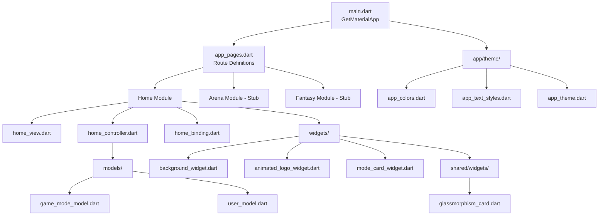
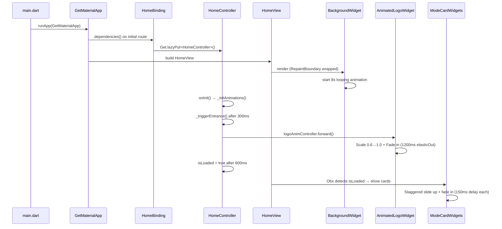
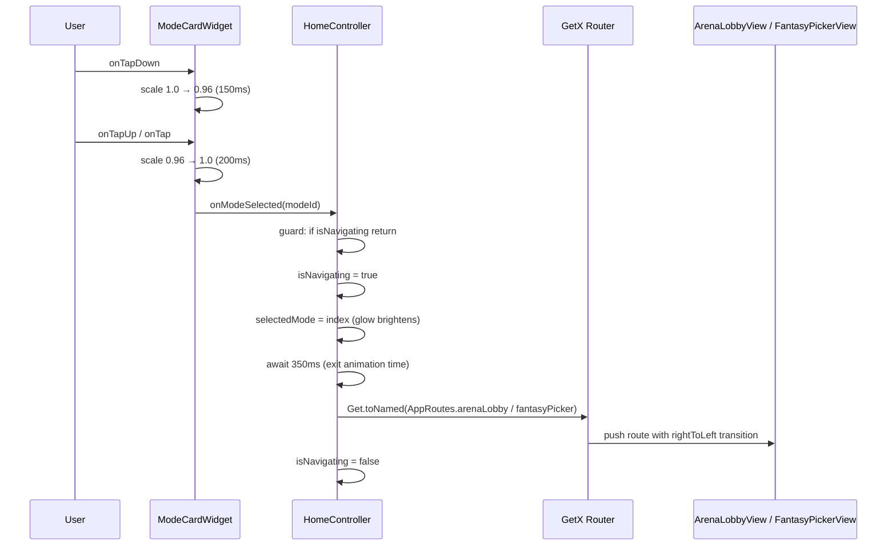

# Design Document: Live Prediction Arena

## Overview

Live Prediction Arena is a mobile Flutter application (iOS + Android) that serves as a game-like hub for live sports prediction. The home screen presents two game modes — Arena (real-time multiplayer predictions) and Fantasy (team-builder scoring) — through an immersive dark UI with rich animations including floating particles, gradient blobs, shimmer effects, and staggered card entrances.

The app follows a module-based MVC architecture using GetX for state management, dependency injection, and routing. Each feature module (home, arena, fantasy) is self-contained with its own view, controller, binding, and widgets. The initial build focuses on the complete home screen experience with stub modules for Arena and Fantasy that will be fleshed out in future sprints.

## Architecture



## Sequence Diagrams

### App Launch Flow



### Mode Selection Flow



## Components and Interfaces

### Component 1: Theme Layer

**Purpose**: Provides centralized color palette, typography, and ThemeData for the entire app. No widget should use hardcoded colors.

```dart
/// app/theme/app_colors.dart
abstract class AppColors {
  static const Color background = Color(0xFF0D1117);
  static const Color cardSurface = Color(0xFF1C2333);
  static const Color cardBorder = Color(0xFF2A3650);
  static const Color electricBlue = Color(0xFF1A56A0);
  static const Color electricBlueGlow = Color(0xFF2E7FE8);
  static const Color arenaAccent = Color(0xFF2E7FE8);
  static const Color fantasyAccent = Color(0xFF7C3AED);
  static const Color success = Color(0xFF22C55E);
  static const Color error = Color(0xFFEF4444);
  static const Color warning = Color(0xFFF59E0B);
  static const Color textPrimary = Color(0xFFFFFFFF);
  static const Color textSecondary = Color(0xFFB0BAD0);
  static const Color textMuted = Color(0xFF5A6785);
}

/// app/theme/app_text_styles.dart
abstract class AppTextStyles {
  static const TextStyle headline;   // 42px bold white, letterSpacing 6
  static const TextStyle title;      // 24px bold white
  static const TextStyle subtitle;   // 14px medium
  static const TextStyle body;       // 13px regular textSecondary
  static const TextStyle caption;    // 12px textMuted
  static const TextStyle overline;   // 13px letterSpacing 4, textSecondary
  static const TextStyle chip;       // 10px bold
}

/// app/theme/app_theme.dart
abstract class AppTheme {
  static ThemeData get darkTheme;  // scaffoldBackground, appBar transparent, etc.
}
```

**Responsibilities**:
- Single source of truth for all visual constants
- Ensures dark theme consistency across all modules
- Provides ThemeData for GetMaterialApp

### Component 2: Models

**Purpose**: Data classes representing domain entities shared across modules.

```dart
/// models/game_mode_model.dart
class GameModeModel {
  final String id;
  final String title;
  final String subtitle;
  final String description;
  final String iconAsset;
  final Color accentColor;
  final Color glowColor;
  final List<String> featureTags;

  const GameModeModel({
    required this.id,
    required this.title,
    required this.subtitle,
    required this.description,
    required this.iconAsset,
    required this.accentColor,
    required this.glowColor,
    required this.featureTags,
  });
}

/// models/user_model.dart
class UserModel {
  final String id;
  final String username;
  final String? avatarUrl;
  final int xp;
  final int level;

  const UserModel({
    required this.id,
    required this.username,
    this.avatarUrl,
    this.xp = 0,
    this.level = 1,
  });
}
```

**Responsibilities**:
- Immutable data containers with const constructors
- Shared across modules via `models/` directory
- No business logic — pure data

### Component 3: HomeController

**Purpose**: Manages all state and animation logic for the home screen.

```dart
/// modules/home/controllers/home_controller.dart
class HomeController extends GetxController
    with GetSingleTickerProviderStateMixin {

  // Observable state
  final RxBool isLoaded = false.obs;
  final RxInt selectedMode = (-1).obs;
  final RxBool isNavigating = false.obs;

  // Animation
  late AnimationController logoAnimController;
  late Animation<double> logoScaleAnim;
  late Animation<double> logoFadeAnim;

  // Data
  final List<GameModeModel> gameModes = [...];

  void onInit();           // init animations + trigger entrance
  void onModeSelected(String modeId);  // navigation with guard
  void onClose();          // dispose logoAnimController
}
```

**Responsibilities**:
- Owns logo animation lifecycle (create, forward, dispose)
- Manages entrance sequencing (delays, isLoaded flag)
- Handles mode selection with navigation guard (prevents double-tap)
- Provides game mode data to the view

### Component 4: BackgroundWidget

**Purpose**: Full-screen animated background with gradient blobs, dot grid, and floating particles.

```dart
/// modules/home/widgets/background_widget.dart
class BackgroundWidget extends StatefulWidget { ... }

class _BackgroundWidgetState extends State<BackgroundWidget>
    with SingleTickerProviderStateMixin {
  late AnimationController _controller;  // 8000ms, repeat(reverse: true)
  late List<_Particle> _particles;       // 10 particles, initialized once

  // Uses CustomPaint with _BackgroundPainter
}

class _BackgroundPainter extends CustomPainter {
  final double animationValue;  // 0.0–1.0 from controller
  final List<_Particle> particles;

  void paint(Canvas canvas, Size size);  // blobs + grid + particles
  bool shouldRepaint(...) => true;       // continuous animation
}

class _Particle {
  double x;        // 0.0–1.0 relative
  double y;        // 0.0–1.0 relative
  double size;     // 2.0–4.0 px
  double speed;    // 0.3–0.8
  double opacity;  // 0.2–0.6
  Color color;     // electricBlue or fantasyAccent
}
```

**Responsibilities**:
- Self-contained animation loop (no dependency on HomeController)
- Efficient rendering via CustomPainter
- Must be wrapped in RepaintBoundary at call site
- Particle positions update each frame based on animation value

### Component 5: AnimatedLogoWidget

**Purpose**: Animated app branding with scale/fade entrance, shimmer effect, and animated underline.

```dart
/// modules/home/widgets/animated_logo_widget.dart
class AnimatedLogoWidget extends StatelessWidget {
  // Reads HomeController via Get.find<HomeController>()
  // Wraps in ScaleTransition + FadeTransition from controller animations
  // Inner: overline text, ARENA title with Shimmer, animated underline, tagline
}
```

**Responsibilities**:
- Reads animation values from HomeController (no own AnimationController)
- Shimmer effect on title text (infinite loop via shimmer package)
- TweenAnimationBuilder for underline width animation
- Pure presentation — no state management

### Component 6: ModeCardWidget

**Purpose**: Interactive game mode selection card with glassmorphism styling and entrance/tap animations.

```dart
/// modules/home/widgets/mode_card_widget.dart
class ModeCardWidget extends StatefulWidget {
  final GameModeModel mode;
  final Duration animationDelay;
  final bool isSelected;
  final VoidCallback onTap;
}

class _ModeCardWidgetState extends State<ModeCardWidget>
    with SingleTickerProviderStateMixin {
  late AnimationController _entranceController;
  late AnimationController _tapController;  // or use single controller
  // Entrance: slide up 40px + fade in after delay
  // Tap: scale 1.0 → 0.96
}
```

**Responsibilities**:
- Self-contained entrance animation (triggered after animationDelay)
- Tap press/release scale animation
- Glassmorphism card styling with accent glow border
- Icon with radial gradient glow
- Feature tag chips layout
- Disposes own AnimationControllers

### Component 7: Shared GlassmorphismCard

**Purpose**: Reusable glassmorphism container widget for cross-module use.

```dart
/// shared/widgets/glassmorphism_card.dart
class GlassmorphismCard extends StatelessWidget {
  final Widget child;
  final Color borderColor;
  final double borderRadius;
  final double borderWidth;
  final Color? glowColor;
  final double glowBlurRadius;

  const GlassmorphismCard({...});
}
```

**Responsibilities**:
- Encapsulates glassmorphism visual pattern
- Configurable border color, glow, and radius
- Used by ModeCardWidget and potentially future modules

### Component 8: Routing

**Purpose**: Centralized route definitions and navigation constants.

```dart
/// app/routes/app_routes.dart
abstract class AppRoutes {
  static const home = '/';
  static const arenaLobby = '/arena/lobby';
  static const fantasyPicker = '/fantasy/picker';
}

/// app/routes/app_pages.dart
class AppPages {
  static final pages = <GetPage>[...];  // GetPage with bindings + transitions
}
```

**Responsibilities**:
- Single source of truth for route names
- Associates routes with views, bindings, and transitions
- No module imports widgets from other modules

## Data Models

### GameModeModel

```dart
class GameModeModel {
  final String id;              // 'arena' | 'fantasy'
  final String title;           // Display name
  final String subtitle;        // Tagline
  final String description;     // Longer description
  final String iconAsset;       // Asset path
  final Color accentColor;      // Primary accent
  final Color glowColor;        // Glow effect color (accent with opacity)
  final List<String> featureTags;  // Chip labels
}
```

**Validation Rules**:
- `id` must be non-empty and unique across game modes
- `iconAsset` must be a valid asset path
- `featureTags` should contain 1–5 items
- `accentColor` and `glowColor` must not be transparent

### UserModel

```dart
class UserModel {
  final String id;
  final String username;
  final String? avatarUrl;
  final int xp;
  final int level;
}
```

**Validation Rules**:
- `id` must be non-empty
- `username` must be 3–20 characters
- `xp` must be >= 0
- `level` must be >= 1

## Key Functions with Formal Specifications

### Function: HomeController.onModeSelected()

```dart
void onModeSelected(String modeId) async
```

**Preconditions:**
- `modeId` is a non-empty string matching a valid game mode id
- Controller is initialized (onInit has completed)

**Postconditions:**
- If `isNavigating` was already true: no state changes occur (guard)
- If `isNavigating` was false: `isNavigating` becomes true, `selectedMode` is updated to matching index, navigation occurs after 350ms delay, `isNavigating` returns to false

**Loop Invariants:** N/A

### Function: HomeController._triggerEntrance()

```dart
void _triggerEntrance() async
```

**Preconditions:**
- `logoAnimController` is initialized
- `isLoaded.value` is false

**Postconditions:**
- After 300ms: `logoAnimController.forward()` is called
- After 900ms total: `isLoaded.value` is true
- Animation values progress from begin to end

### Function: _BackgroundPainter.paint()

```dart
void paint(Canvas canvas, Size size)
```

**Preconditions:**
- `canvas` and `size` are valid (size > 0)
- `animationValue` is in range [0.0, 1.0]
- `particles` list is non-empty

**Postconditions:**
- Canvas has background fill drawn
- Two gradient blobs drawn at positions offset by animationValue
- Dot grid drawn (static positions)
- All particles drawn at positions derived from animationValue
- Particles that exceed bounds wrap to opposite edge

### Function: ModeCardWidget entrance animation

```dart
void _startEntranceAnimation()
```

**Preconditions:**
- `widget.animationDelay` is a non-negative Duration
- `_entranceController` is initialized

**Postconditions:**
- After `animationDelay` elapses: animation controller forwards
- Card translates from +40px to 0px on Y axis
- Card opacity transitions from 0.0 to 1.0
- Animation completes in 500ms with easeOutCubic curve

## Example Usage

```dart
// main.dart — App entry point
void main() {
  runApp(const LivePredictionArenaApp());
}

class LivePredictionArenaApp extends StatelessWidget {
  const LivePredictionArenaApp({super.key});

  @override
  Widget build(BuildContext context) {
    return GetMaterialApp(
      title: 'Live Prediction Arena',
      debugShowCheckedModeBanner: false,
      theme: AppTheme.darkTheme,
      initialRoute: AppRoutes.home,
      getPages: AppPages.pages,
      defaultTransition: Transition.fadeIn,
    );
  }
}

// HomeView — composing widgets
class HomeView extends GetView<HomeController> {
  const HomeView({super.key});

  @override
  Widget build(BuildContext context) {
    return Scaffold(
      backgroundColor: AppColors.background,
      body: Stack(
        children: [
          const RepaintBoundary(child: BackgroundWidget()),
          SafeArea(
            child: Padding(
              padding: const EdgeInsets.symmetric(horizontal: 24.0),
              child: Column(
                children: [
                  const SizedBox(height: 48),
                  AnimatedLogoWidget(),
                  const SizedBox(height: 56),
                  Obx(() => AnimatedOpacity(
                    opacity: controller.isLoaded.value ? 1.0 : 0.0,
                    duration: const Duration(milliseconds: 500),
                    child: Column(
                      children: controller.gameModes
                          .asMap()
                          .entries
                          .map((entry) => Padding(
                                padding: const EdgeInsets.only(bottom: 20),
                                child: ModeCardWidget(
                                  mode: entry.value,
                                  animationDelay: Duration(milliseconds: 150 * entry.key),
                                  isSelected: controller.selectedMode.value == entry.key,
                                  onTap: () => controller.onModeSelected(entry.value.id),
                                ),
                              ))
                          .toList(),
                    ),
                  )),
                  const Spacer(),
                  Text('v1.0.0 · Fan Squad Challenge', style: AppTextStyles.caption),
                  const SizedBox(height: 16),
                ],
              ),
            ),
          ),
        ],
      ),
    );
  }
}

// Using GetX binding for dependency injection
class HomeBinding extends Bindings {
  @override
  void dependencies() {
    Get.lazyPut<HomeController>(() => HomeController());
  }
}
```

## Error Handling

### Error Scenario 1: Missing Asset Icons

**Condition**: `assets/icons/arena_icon.png` or `fantasy_icon.png` not found at runtime
**Response**: Flutter renders a broken image placeholder; app does not crash
**Recovery**: Use `Image.asset` with `errorBuilder` to show a fallback icon (e.g., Material icon)

### Error Scenario 2: Double-Tap Navigation

**Condition**: User taps a mode card while navigation is already in progress
**Response**: `onModeSelected` guard (`if (isNavigating.value) return`) prevents duplicate navigation
**Recovery**: No recovery needed — guard prevents the issue entirely

### Error Scenario 3: Animation Controller Access After Dispose

**Condition**: Widget tries to access animation controller after route is popped
**Response**: GetX controller's `onClose()` disposes the controller; GetX lifecycle prevents post-dispose access
**Recovery**: GetX recreates controller on next route visit via `lazyPut`

### Error Scenario 4: Invalid Mode ID

**Condition**: `onModeSelected` called with an ID that doesn't match any game mode
**Response**: `indexWhere` returns -1, `selectedMode` set to -1, no navigation occurs (neither if-branch matches)
**Recovery**: No crash — graceful no-op

## Testing Strategy

### Unit Testing Approach

- Test `HomeController` logic: entrance sequencing, navigation guard, mode selection
- Test `GameModeModel` construction and data integrity
- Test `UserModel` validation rules
- Mock `Get.toNamed` to verify correct route is called on mode selection
- Use `flutter_test` with GetX test utilities (`Get.testMode = true`)

### Widget Testing Approach

- Test `ModeCardWidget` renders correct title, subtitle, description, and chips
- Test `AnimatedLogoWidget` displays correct text content
- Test `HomeView` composition — all child widgets present
- Test tap interactions trigger callbacks
- Use `WidgetTester` with `pumpAndSettle` for animations

### Integration Testing Approach

- Full app launch → verify home screen renders
- Tap Arena card → verify navigation to ArenaLobbyView
- Tap Fantasy card → verify navigation to FantasyPickerView
- Verify background animation runs without errors

## Performance Considerations

- `RepaintBoundary` wraps `BackgroundWidget` to isolate continuous repaints from the widget tree above
- `CustomPainter` with `shouldRepaint: true` only on the background — content layer doesn't repaint on background frames
- Particle positions computed from animation value (no per-frame allocations)
- Dot grid is static — could be cached as an image for further optimization
- `const` constructors used wherever possible to enable widget caching
- `Get.lazyPut` ensures controllers only instantiate when their route is first accessed

## Security Considerations

- No sensitive data stored locally in this initial build
- Future sprints using `get_storage` should not store auth tokens in plain text
- WebSocket connections (future) should use WSS (secure WebSocket)
- API calls via `dio` should use HTTPS only
- No user input validation needed in this sprint (no text fields)

## Dependencies

| Package | Version | Purpose |
|---------|---------|---------|
| get | ^4.6.6 | State management, DI, routing |
| get_storage | ^2.1.1 | Local key-value storage (future use) |
| dio | ^5.4.0 | HTTP client (future use) |
| web_socket_channel | ^2.4.0 | WebSocket for real-time (future use) |
| flutter_animate | ^4.5.0 | Declarative animations (utility) |
| shimmer | ^3.0.0 | Shimmer text effect on logo |

## Correctness Properties

*A property is a characteristic or behavior that should hold true across all valid executions of a system — essentially, a formal statement about what the system should do. Properties serve as the bridge between human-readable specifications and machine-verifiable correctness guarantees.*

### Property 1: Navigation guard prevents concurrent navigation

*For any* sequence of rapid calls to `onModeSelected`, the system SHALL execute navigation at most once per cycle — while `isNavigating` is true, subsequent calls are no-ops, ensuring no duplicate route pushes occur regardless of call frequency.

**Validates: Requirements 4.2**

### Property 2: Mode selection maps to correct route

*For any* valid game mode ID from the `gameModes` list, calling `onModeSelected(id)` SHALL result in `Get.toNamed` being called with the route corresponding to that mode — 'arena' always maps to `/arena/lobby` and 'fantasy' always maps to `/fantasy/picker`.

**Validates: Requirements 4.3**

### Property 3: Particle position invariant

*For any* animation value in [0.0, 1.0] and *for any* particle in the background system, the computed particle position (after wrapping logic) SHALL always remain within valid canvas bounds [0.0, 1.0] for both X and Y coordinates.

**Validates: Requirements 5.3**

### Property 4: ModeCardWidget displays all model fields

*For any* valid GameModeModel instance, the rendered ModeCardWidget SHALL contain text matching the model's title, subtitle, description, and all items in featureTags — no field is silently dropped.

**Validates: Requirements 7.2**

### Property 5: GlassmorphismCard renders with provided configuration

*For any* valid combination of borderColor, borderRadius (> 0), and optional glowColor, the GlassmorphismCard SHALL render a Container whose BoxDecoration matches the provided border color, radius, and glow shadow color.

**Validates: Requirements 12.2**
